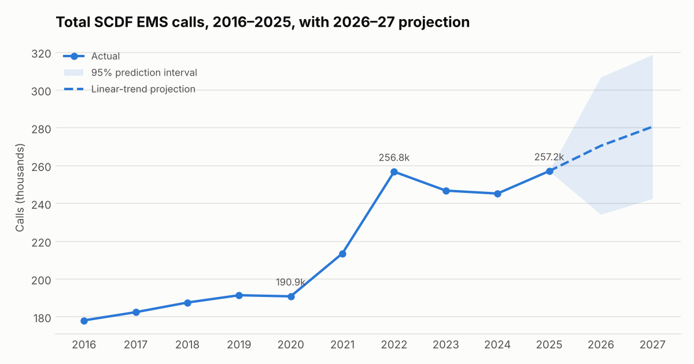
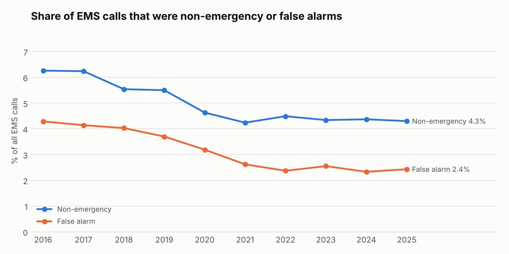
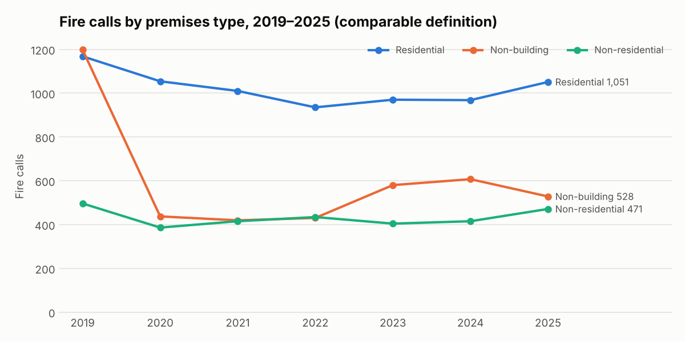
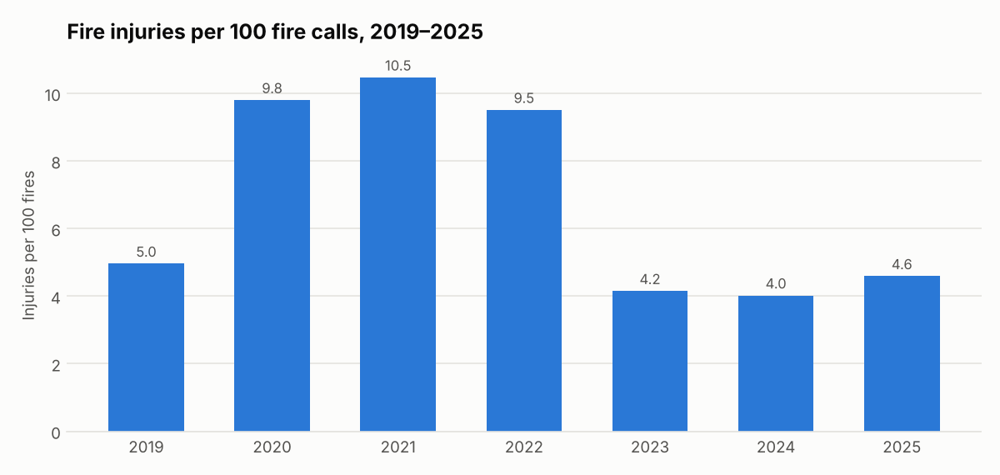

# SCDF Incident Trends: EMS and Fire Demand Analysis, 2016–2025

[](https://github.com/Delphinoc/scdf-incident-trends/actions/workflows/ci.yml)

An analysis of how demand on the Singapore Civil Defence Force (SCDF) has changed over the last decade. It uses SCDF's published annual statistics on emergency medical services (EMS) calls, fire calls and fire casualties, which SingStat republishes on data.gov.sg. The analysis is built on a SQL model with 40 automated data-quality and reconciliation tests.

**Questions**
1. How fast is EMS demand growing, and is the growth driven by population growth alone?
2. How much EMS capacity goes to calls that turn out to be non-emergencies or false alarms?
3. Which fire incident types drive the fire workload, and how stable is each one?
4. What EMS volume should planners expect in 2026–27?

## Key findings

All figures come from `reports/stats.json`, which `src/analyse.py` generates.

**1. EMS demand grew 44% in nine years and moved to a higher baseline after 2021.**
EMS calls rose from 178,154 in 2016 to 257,158 in 2025, a compound annual growth rate of 4.2%. That's about 487 calls a day in 2016 against 705 a day in 2025.

Growth was steady until 2020, when calls dipped 0.3%. They then jumped 11.9% in 2021 and 20.2% in 2022, and have stayed between about 245k and 257k a year since. This looks like a lasting rise in the baseline, not a one-off spike.



**2. Demand is outpacing population.**
EMS calls per 1,000 people rose from 32.5 in 2017 to 40.6 in 2024. Over that period calls grew 34.4% while total population grew only 7.6%. SCDF's 2025 release says 49.7% of EMS calls involved people aged 65 and over, which points to population ageing as a likely driver. The release doesn't break this down by year, so this analysis doesn't test it.

**3. The call mix has improved, but about 47 non-emergency or false-alarm calls a day still take up ambulance capacity.**
Non-emergency and false-alarm calls fell from 10.6% of all EMS calls in 2016 to 6.7% in 2025. In 2025 that was still 17,303 calls, or about 47 a day. Moving more of these calls to alternatives such as the 1777 non-emergency ambulance line or nurse-led triage would free ambulances for emergencies.



**4. Planning range for 2026 is about 234k to 307k EMS calls.**
A linear trend fitted to 2016–2025 adds about 10,100 calls a year (R² = 0.86). It projects 270,548 calls for 2026, with a 95% prediction interval of 234,215 to 306,881. Leaving out the COVID years 2020–21 gives almost the same result: 273,320 calls. The interval is wide because there are only 10 annual points and the series has a structural break. Treat it as a planning range, not a forecast.

**5. Fire calls are under 1% of the workload, and residential fires are both the largest and the most predictable category.**
In 2025, EMS made up 99.2% of combined EMS and fire calls, about 125 EMS calls for every fire call. Fire calls bottomed out at 1,799 in 2022 and rose 14.0% to 2,050 in 2025.

Residential fires were 51.3% of fire calls in 2025 and are the most stable category, with a coefficient of variation of 4.9% over 2020–2025. Non-building fires (vegetation, vehicles, open areas) vary far more, at 16.5%, so they are the harder category to plan for. Residential fires are up 12.4% since 2022.



**6. A fall in the fire injury rate needs a definition check before anyone reports it as a safety gain.**
Fire injuries per 100 fires were 9.5 to 10.5 in 2020–2022, then fell to 4.2 in 2023: injuries went from 171 to 81 in a single year. A change that abrupt more often means a change in how injuries were counted than a real drop. SCDF's 2025 release defines a fire injury as a case admitted to hospital after SCDF conveyance. See *Data quality* below.



## Data quality

Data quality was treated as a deliverable in its own right, not as a cleaning step.

### Comparability rules (enforced in `sql/model.sql` and tested)

| Rule | Issue | Treatment |
|---|---|---|
| R1 | From 2016, SCDF reclassified EMS calls into Emergency, Non-Emergency and False Alarm. Earlier years can't be compared directly. | Call-mix and trend analysis uses 2016 onwards (`comparable_series` flag). |
| R2 | From 2019, fire counts exclude minor fires such as rubbish bins and chutes. | Fire analysis uses 2019 onwards. |
| R3 | The population snapshot covers 2017–2024 only. | Per-capita rates are limited to those years. |

### Issues flagged for follow-up rather than silently "fixed"

- **2019 non-building fires (1,198)** are 2.4 times the 2020–2025 average of about 500. 2019 is the first year of the minor-fire exclusion, so the rule may not have been applied consistently across the year. I keep the value but don't use 2019 as a baseline for non-building trends.
- **The 2022 to 2023 drop in fire injuries (171 to 81)** may reflect a change in how injuries were defined or recorded. It needs confirming with the data owner before it's used in reporting.

### Automated tests (`pytest`, 40 tests)

- **Completeness:** every series has contiguous years with no duplicates, nulls or negatives.
- **Internal reconciliation:** each year, EMS call types sum to the total, residential plus non-residential fires equal building fires, and building plus non-building fires equal total fires.
- **Cross-dataset reconciliation:** SingStat's fire fatality rate is recomputed from fatalities and an independent population dataset, and it matches for all 8 overlapping years. This also confirms the rate is per 100,000 population, which the dataset doesn't state.
- **Cross-source reconciliation:** 14 data.gov.sg values match SCDF's own 2025 annual statistics release, and EMS calls per day matches the published figure of 705.
- **Model checks:** the comparability flags are correct, percentage shares sum to 100%, joins don't duplicate rows, and leap years are handled in calls-per-day.
- **Independent recomputation:** the key SQL metrics are recomputed in pandas without using SQL.
- **Projection maths:** the regression recovers a known line, and prediction intervals widen with the forecast horizon.
- **Reproducibility:** rebuilding from raw gives identical outputs, and raw files are never modified. CI also re-runs the analysis and fails if the committed stats or tables would change.

### Provenance

`data/raw/` is a snapshot of these data.gov.sg datasets, published by SingStat and sourced from SCDF:

| File | Dataset | data.gov.sg ID |
|---|---|---|
| `ems_calls_annual.csv` | Emergency Medical Services, Annual | `d_d0b4ca9fad1c5fee38d7ddfd7303845f` |
| `fire_occurrences_annual.csv` | Fire Occurrences, Annual | `d_808473a208220960f07a0b064ef16bde` |
| `fire_injuries_fatalities_annual.csv` | Fire Injuries And Fire Fatalities, Annual | `d_2c81b575edc555f6c8f0cb7e09c8df02` |
| `population_annual.csv` | Indicators On Population, Annual (SingStat Table Builder M810001), 2017–2024 | – |

`data/reference/scdf_2025_release_anchors.csv` holds figures from the SCDF Annual Statistics 2025 release, used for cross-checking.

`scripts/fetch_data.py` downloads the three SCDF datasets from the data.gov.sg API into `data/raw/`. With `--check`, it instead compares the committed snapshot against the live data and fails on any difference. CI runs this check on every push and monthly, so data.gov.sg revisions or a new year of data are picked up automatically.

Data is used under the [Singapore Open Data Licence](https://data.gov.sg/open-data-licence).

## Method

1. `src/build_model.py` loads the raw CSVs into SQLite and builds five views from `sql/model.sql`: `ems_annual`, `fire_annual`, `fire_severity`, `workload_mix` and `ems_per_capita`. The database is rebuilt from scratch on every run.
2. `src/analyse.py` reads only comparable years, then writes the summary tables (`reports/tables/`), the headline stats (`reports/stats.json`) and the charts.
3. **Projection:** an ordinary least squares linear trend on annual totals, with 95% prediction intervals from the t-distribution (n−2 degrees of freedom). A sensitivity run leaves out 2020–21. A linear trend is used on purpose: with 10 data points, a more complex model would overfit.
4. **Volatility:** the coefficient of variation (standard deviation divided by mean) over 2020–2025 compares how predictable each fire category is.

## Limitations

These are national annual totals. They show demand patterns, but they can't measure response times, locations, time of day, or station-level deployment and utilisation. With incident-level records, the next steps would be:

- response-time distributions against SCDF's targets, by division and time of day
- heat maps of demand by hour and location, to support resource positioning
- unit utilisation and concurrent-incident load, to identify readiness pressure points

## Reproduce

```bash
pip install -r requirements.txt
python src/analyse.py              # builds data/processed/scdf.sqlite, then tables, stats and figures
python -m pytest                   # 40 tests
python scripts/fetch_data.py --check  # compare the snapshot against live data.gov.sg
python scripts/fetch_data.py          # refresh data/raw from data.gov.sg
```

## Project structure

```
data/raw/            snapshot of source data (never modified by the pipeline)
data/reference/      SCDF 2025 release figures used for cross-source checks
sql/model.sql        analytical views and comparability rules
src/                 build_model.py (load + model), analyse.py (metrics, projection, charts)
scripts/             fetch_data.py (download / --check against data.gov.sg)
.github/workflows/   CI: tests, output reproducibility, live data check
tests/               data-quality and model/analysis tests
reports/             stats.json, tables/, figures/
```

**Stack:** SQL (SQLite), Python (pandas, NumPy, SciPy, matplotlib), pytest.

## Licence

Code: MIT © 2026 Delphino Chew Jing Cheng. Data: Singapore Open Data Licence. This is an independent portfolio project and is not affiliated with or endorsed by SCDF.
